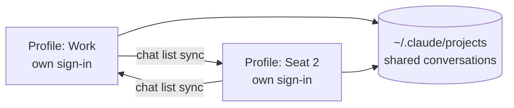

# Tango for Claude

Use several Claude seats on one computer, side by side, without logging out and without
losing chats. Each **profile** is its own Claude desktop window or Claude Code terminal
with its own sign-in, and every profile sees every Code-tab chat.

> Open source (MIT). Not affiliated with or endorsed by Anthropic.

## Why
The Claude desktop app lists only the signed-in account's Code-tab chats. Switch
accounts and the other account's chats seem to vanish. They aren't deleted: the
conversations live in `~/.claude/projects`, shared by every account, and only the list
entry is per account. Tango for Claude copies those list entries between your seats, so
you can start a chat on one seat and continue it on another.



## Download
Get the latest release from this repository's **Releases** page:

| System | File |
|---|---|
| macOS (Apple Silicon and Intel) | `tango-for-claude-<version>-macos-universal.zip` |
| Windows 10/11 (x64) | `…-windows-x64-setup.exe` (installer) or `…-windows-x64-portable.exe` |
| Linux (x86_64) | `…-linux-x86_64.AppImage` or `….tar.gz` (needs GTK 4 and WebKitGTK 6.0, e.g. Ubuntu 24.04+, Fedora 40+) |

The builds are **not code-signed**, so the first start needs one extra step:
- **macOS:** unzip, move *Tango for Claude* to Applications, then right-click it → **Open**
  → **Open**. Only needed once.
- **Windows:** if SmartScreen appears, click **More info** → **Run anyway**.
- **Linux:** `chmod +x` the AppImage, then run it.

Check a download against `SHA256SUMS.txt` from the same release if you want to be sure
it wasn't changed.

**Coming from "Tandem for Claude" (0.1.0-beta.1)?** It's the same app, renamed. Quit
Tandem for Claude (tray icon → **Quit**), delete it, and install Tango for Claude. Your
profiles, sign-ins, backups and settings are kept. If start at login was on, Tango takes
it over on its first start.

## Using it
1. Open **Tango for Claude**. You'll see two built-in profiles: your normal Claude
   window and plain `claude` in a terminal.
2. Click **New profile**, give it any name (for example "Seat 2"), and choose:
   - **Desktop:** a separate Claude desktop window.
   - **Terminal:** Claude Code in a terminal.
3. **Desktop profile:** the app starts the one-time **Sign in**. Claude sends the
   sign-in to the first Claude window that's open, so the app closes the others for a
   moment (it asks first), opens only the new profile, and reopens the others when you
   click **Done**.
   **Terminal profile:** click **Open terminal** and log in when Claude Code asks.
4. From then on, click **Open** on any profile, in the window or from the tray / menu
   bar icon. Profiles stay signed in. If a profile is already open, **Open** brings its
   window to the front (macOS may ask once to allow this).

Chats are synced in the background every 5 minutes (change it in **Settings**). Claude
reads its chat list when it starts, so **restart a Claude window to see newly synced
chats**.

**Keep one chat open in only one profile at a time.** Two seats writing to the same
chat at once can mix up its messages. The **Sync** tab warns you when this happened.

### What is kept where
| What | Where |
|---|---|
| Profiles, settings, backups, sync state, log | `~/.claude-profile/` (Windows: `%USERPROFILE%\.claude-profile\`) |
| A desktop profile's Claude data and sign-in | `~/.claude-profile/profiles/<id>/` |
| A terminal profile's Claude Code folder | `~/.claude-profile/cli/<id>/`: links to your shared `~/.claude` items, plus its own sign-in and `.claude.json` |
| Conversations | `~/.claude/projects/`, shared by every profile |

### Safety
- Nothing is ever deleted from Claude's folders. A chat deleted in one profile gets a
  "deleted" marker in the others, so it stays deleted there too.
- Before any sync that changes something, the chat lists are backed up (the newest 20
  are kept). Restore them from the **Backups** tab after quitting every Claude window.
- While Claude is running, sync only adds new files. It updates existing ones only when
  every Claude window is closed.
- If Claude changes its file format in an update, sync **pauses** and says so instead
  of guessing.
- The app never reads or copies sign-ins, tokens, cookies or the keychain, and makes
  no network requests of its own.

### Known limits
- **Sidebar layout** (projects, groups, pins) is stored separately in each desktop
  window and is not synced. Set it up once per profile.
- **Every desktop window has the same Claude icon** in the Dock / taskbar. Tell them
  apart by the account shown inside, or open them from the tray menu.
- **Windows and Linux** are built and tested automatically, but haven't been tried on
  a real machine yet. Linux has no official Claude desktop; desktop profiles work only
  with a community build, while terminal profiles work everywhere.
- **Old chats:** Claude Code itself deletes conversations older than
  `cleanupPeriodDays` (30 days by default). Raise it under **Settings → Keep old chats**
  (or `tango retention 365`). Your other Claude Code settings are kept, and the
  previous file is saved as `settings.json.before-tango`.
- Relies on Claude's internal file layout (tested with Claude desktop 6.6395.1 on macOS).

## Command line
The same program works as a command-line tool when given arguments. On macOS the
binary is inside the app: `"/Applications/Tango for Claude.app/Contents/MacOS/tango"`.

```bash
tango status
```
```bash
tango sync --apply
```
```bash
tango profile add "Seat 2" --kind desktop
```
```bash
tango profile signin <id>
```
Run `tango help` for every command (profiles, backups, start at login, chat retention).

## Build from source
Prerequisites: Go 1.26+, Node.js 22+, and the Wails CLI:
```bash
go install github.com/wailsapp/wails/v3/cmd/wails3@v3.1.0
```
Linux also needs `libgtk-4-dev` and `libwebkitgtk-6.0-dev` (Ubuntu 24.04 or newer).

Run in development mode:
```bash
wails3 dev
```
Build for this computer (output in `bin/`):
```bash
wails3 build
```
Package (`.app`, Windows installer or AppImage):
```bash
wails3 package
```
Tests (core logic, no UI, synthetic data only):
```bash
go test ./internal/...
```
Releases are built by GitHub Actions (`.github/workflows/release.yml`) when a `vX.Y.Z`
tag is pushed.

## Configuration
Every setting has a default. For testing you can point the app at other folders with
environment variables (see `.env.example`): `CLAUDE_PROFILE_HOME`,
`CLAUDE_PROFILE_APP_DATA`, `CLAUDE_PROFILE_CLAUDE_DIR`, `CLAUDE_PROFILE_PROJECTS`.

## Project layout
| Folder | What |
|---|---|
| `internal/domain` | Pure rules: sync planning, profile names. No I/O. |
| `internal/app` | Use cases: sync, profiles, sign-in helper, settings, backups. |
| `internal/ports` | Interfaces the use cases depend on. |
| `internal/adapters` | File system (`fsstore`) and per-OS code (`platform`). |
| `internal/cli`, `ui`, `frontend` | Thin front-ends: command line, window + tray, page. |
| `documents/` | Change requests, change notes, test cases. See [documents/README.md](documents/README.md). |

## Licence
MIT. See [LICENSE](LICENSE).
