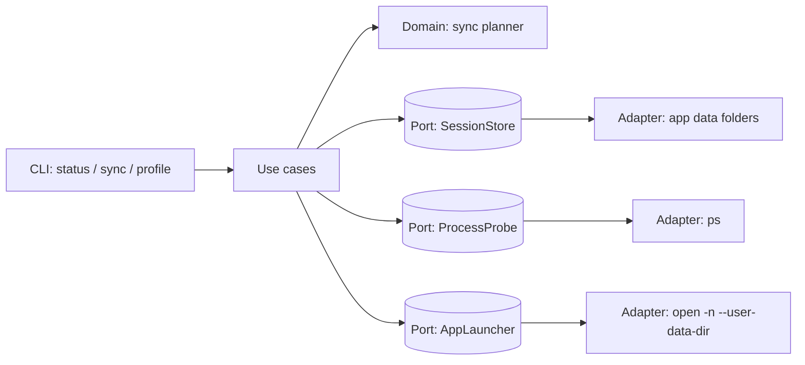
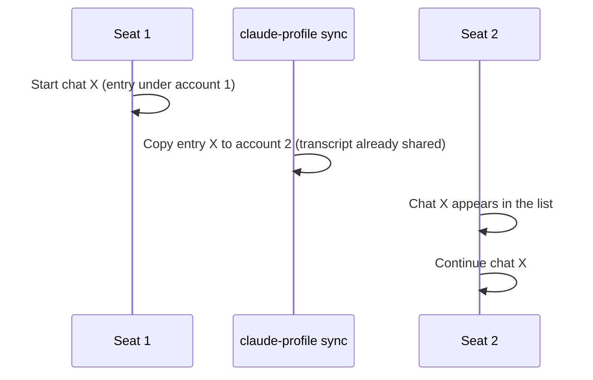

# v0.1.0 - Change Request: Cross-account chat sync

| | |
|---|---|
| **CR id** | CR-0.1.0-01 |
| **Version** | 0.1.0 (target; Alpha) |
| **Status** | Beta (0.1.0-beta.1). Implemented by CR-0.1.0-02 |
| **Owner** | naseebnaushad |
| **Branch** | `feature/chat-sync` |
| **Date** | 2026-11-20 |

## 1. Summary
The developer uses two Claude Team premium seats in the Claude desktop app (Code tab).
After switching accounts, the other account's Code-tab chats disappear from the list.
Investigation showed that they are **hidden, not deleted**. The app files each chat's list
entry under the signed-in account, while the full conversation (transcript) sits in
`~/.claude/projects`, which both accounts share. `claude-profile` is a small macOS tool
that makes every chat visible and resumable from either seat (chat sync). It can also run
a second copy of Claude.app, so both seats are open side by side (profiles).

## 2. Answers to the clarifying questions
| Topic | Answer |
|---|---|
| Goal | Never lose Code-tab chats when using two seats. Main goal: start a chat on seat 1 and continue it on seat 2, for example when seat 1 hits its usage limit. |
| Users | The developer only, on macOS. The project may later be released as open source, so it must not contain anything specific to this developer. |
| In scope | Code tab of the Claude desktop app. Chat sync between accounts. Optional side-by-side profiles. Both options available ("both is better, either is fine"). |
| Out of scope | Regular claude.ai chats (they are stored in the cloud per account). Recovering past chats (not needed, and nothing is actually lost). Windows/Linux. Sharing between different organisations. |
| Edge cases | The app is running while sync writes. A chat is deleted on one seat. The same chat is open on both seats at once. The app updates its file format. A transcript is missing. A profile folder is removed. |
| Constraints | Must not touch or risk the developer's current chats. No network access, no secrets, no keychain or cookie access. No new global tools without approval. |
| Definition of done | Seat 1 and seat 2 can be used side by side or by switching. Both stay signed in. A chat started on one seat shows up on the other and can be continued there. No chat is lost after a restart or a switch. |

## 3. Impact analysis
This is a new, empty project (not yet a git repo), so there is no code to break. All
impact is on data that belongs to the Claude desktop app. These findings come from
read-only inspection on 2026-11-20, Claude desktop 6.6395.1.

| Area / file | How it is affected | Action |
|---|---|---|
| `~/Library/Application Support/Claude/claude-code-sessions/<account>/<org>/local_<id>.json` | One file per chat in the Code-tab list. Holds `sessionId`, `cliSessionId` (the transcript id), `cwd`, title, timestamps and about 45 other fields. Today: 16 chats under one account and 6 under the other, same org. | **Change.** Sync adds missing entries to the other account's folder. It overwrites an existing entry only when the app is closed (D3). |
| `…/<account>/<org>/deleted_<id>` | Tombstone marking a deleted chat. Contains a millisecond timestamp. | **Change.** Copied to the other account so deletes carry over and deleted chats never come back. |
| `…/<account>/<org>/scheduled-tasks.json` | Scheduled tasks per account. | **None.** Not synced (could run tasks twice). |
| `~/.claude/projects/<project>/<cliSessionId>.jsonl` | The full conversation. Shared by both accounts. All 22 chats have their transcript. | **Read only.** Used to check that an entry is resumable. Never written. |
| Account-tied fields in an entry: `bridgeSessionIds`, `remoteControlUserEnabled`, `remoteControlAutoEligible`, `steeredByRemoteClient` | Tied to the account that created the chat (Remote Control). | **Change.** Cleared in the copy so the other account doesn't try to reuse them (to be verified, OQ2). |
| Rest of `~/Library/Application Support/Claude` (cookies, local storage, config, `claude-code`, etc.) | Holds sign-in and app state. | **None.** Never read or written. |
| macOS keychain | Holds sign-in tokens. | **None.** Never touched. |
| Profile data folders (new, `~/.claude-profile/profiles/<name>/`) | Each one is a separate Claude.app data folder with its own sign-in. Its `claude-code-sessions` takes part in sync. | **New.** |
| `/Applications/Claude Profiles.app` (third-party, already installed, no profiles yet) | Does side-by-side profiles but no chat sync. Uses `~/.claude-instances`. | **None.** Left alone. A note in the README will say not to use both tools on the same profile. |

Suggested related improvements (not in scope unless approved):
- A small menu bar app instead of the command line.
- A notification when a chat is open on both seats at once.

## 4. Design

### Chat sync
Everything works on **stores**, one per `<data folder>/<account>/<org>`. Sync only pairs
stores with the **same org**.

1. **Read.** Load every entry and tombstone from every store: the default data folder plus
   every profile. Skip and report anything that fails the format check (D5).
2. **Plan (pure logic, no I/O).**
   - Every chat with a tombstone in any store is deleted everywhere. Add the tombstone to
     each store where that chat is still live (stores without the chat don't need one). Never delete an entry file; the app handles tombstoned
     entries itself (to be verified, OQ3).
   - A live chat missing from a store is **added** there as a copy with the account-tied
     fields cleared.
   - When a chat exists in several stores, the copy with the newest `lastActivityAt` wins.
     The older copies are **updated**, but only while Claude is closed.
   - Skip any chat whose transcript is missing, and report it.
3. **Show** the plan. The default is a dry run, and `--apply` writes it.
4. **Apply.** Back up first, then write each file atomically (D6).

### Profiles
`claude-profile profile add <name>` creates a data folder and a small `.app` launcher in
`~/Applications`. The launcher runs `open -n -a Claude --args --user-data-dir=<folder>`.
You sign in once in that window. The default Claude.app stays as it is, as the other seat.
Both copies share `~/.claude`, so transcripts are shared and sync covers both.

### Commands
| Command | What it does |
|---|---|
| `claude-profile status` | Lists stores, chat counts, what is out of sync, and whether Claude is running. Read only. |
| `claude-profile sync [--apply]` | Plans or applies the sync. |
| `claude-profile profile add / list / open / remove <name>` | Manages side-by-side profiles. `remove` deletes only the launcher and asks before deleting the data folder. |
| `claude-profile agent install / uninstall` | Optional LaunchAgent that runs `sync --apply` every few minutes and at login. When Claude is running it only adds entries. |
| `claude-profile backups list / restore <id>` | Restores a backup of the chat lists. |

### Decisions
| # | Decision | Reason | Alternatives considered |
|---|---|---|---|
| D1 | Build our own tool and leave Claude Profiles alone. | Chat sync is the main goal and that tool doesn't have it. Our own code can be reviewed and open-sourced. | Use Claude Profiles plus a sync script (two tools touching the same folders, harder to keep safe). |
| D2 | Python 3 standard library only, no third-party packages. | Already on this Mac (`python3`). No global install needed, no dependencies to audit, easy for others to read. | Go: single binary, but not installed, which needs approval. Swift: native menu bar, but more work for v0.1.0. |
| D3 | When Claude is running, only **add** missing files. Update or overwrite existing entries only when every Claude copy is closed. | The app keeps open chats in memory and may rewrite their files. Adding a new file is the least risky change. | Always overwrite (risk of the app overwriting our change or the reverse). Symlinking entries between accounts (the app may replace the link with a file, or behave oddly). |
| D4 | Never delete files in the app's folders. Deletes are carried over only as tombstones. | Nothing can be lost by mistake. | Delete the entry file (not reversible). |
| D5 | Strict format check: the entry must be JSON with string `sessionId`, `cliSessionId` and `cwd`, and the tombstone must be digits only. Anything else is skipped and reported. | The format is internal to the app and can change with any update. Stop instead of guessing. | Copy unknown files as they are. |
| D6 | Before the first write of each run, back up all `claude-code-sessions` folders to `~/.claude-profile/backups/<time>.tar.gz` (permissions 0600, keep the last 20). Writes go to a temp file, then `rename`, with permissions 0600 like the app's own files. | Easy undo. No half-written files. | No backup. |
| D7 | Warn, and don't block, when the same chat has new activity on two seats since the last sync. Each seat's copy time at the last sync is kept in `~/.claude-profile/state.json`. | Two seats writing one transcript at once can corrupt it. The tool can't lock the app, so the rule is "one chat open in one place at a time", and the tool warns. | Try to lock transcripts (not possible from outside the app). |
| D9 | **Switching accounts plus background sync is the main way. Side-by-side profiles stay in, marked experimental.** Chosen by the developer on 2026-11-20 after testing (OQ4). | Side by side worked against the app: the `claude://` sign-in link goes to the first running copy, a Dock click focuses the running copy instead of opening another, and the sidebar layout (projects, groups) is stored per copy in browser storage that sits next to sign-in data, so it can't be copied safely. | Keep pushing side by side. Copy the app under a new name or bundle id (breaks its code signature and auto-update, and the sign-in link is still shared). |
| D8 | Profiles share `~/.claude` and don't set `CLAUDE_CONFIG_DIR`. | The shared transcripts are what make continuing on the other seat work. | A separate `CLAUDE_CONFIG_DIR` per profile (would split transcripts and break the goal). |

## 5. Feature parity (rewrites/migrations only)
Not applicable. This is a new tool.

## 6. Security checklist
- [ ] Input validated and length-limited at boundaries. Entry files over 10 MB are skipped, names must match `local_<uuid>.json` or `deleted_<uuid>`, and folder names must be UUIDs. Profile names are limited to `[a-z0-9-]`, 1–32 characters, so no path tricks.
- [ ] Output encoded for context. Titles are printed with control and escape characters stripped. There is no web UI.
- [ ] AuthN/AuthZ. Not applicable (local tool, no server). Least privilege: the tool reads and writes only `claude-code-sessions` and its own `~/.claude-profile`, and reads `~/.claude/projects` file names only.
- [ ] Secrets never touched. No cookies, local storage, config, keychain or `.env`. Nothing is logged except file names, counts and ids.
- [ ] Errors generic to the user, details in `~/.claude-profile/log` (0600) with no chat content.
- [ ] TLS and timeouts. No network calls at all.
- [ ] New dependencies. None (standard library only).
- [ ] Vulnerability scan clean (`pip-audit` has nothing to scan; a secret scan of the repo runs before release).

## 7. Dependencies
| Package | Version | Licence | Why needed |
|---|---|---|---|
| Python 3 (macOS system or Xcode Command Line Tools) | ≥ 3.9 | PSF | Runtime. Not bundled. |

## 8. Test approach
- **Unit tests** (`unittest`, standard library) for the sync planner. They use synthetic entries in temp folders and never the real app folders. Covers: add missing, tombstone wins, newest wins, running-app add-only, missing transcript, bad files, two orgs not mixed, profile name validation.
- **Integration tests** on a temp copy of a fake `Application Support` tree. They cover backup, atomic writes, permissions and restore.
- **Manual tests on the real app** (recorded in the Alpha Test Cases). Take a backup first, then: (1) run sync and check that seat 2 shows seat 1's chats; (2) continue a seat 1 chat on seat 2 and check the reply has the earlier context; (3) delete a chat on one seat, sync, and check it stays gone on the other; (4) open a profile side by side with the default app, with both signed in; (5) restart both and check nothing is lost.

## 9. Open questions
- **OQ1. Partly answered 2026-11-20; the rest deferred to Beta testing (SYNC-M04):** after a restart the app lists a copied entry under the other account and loads its history (checked with one older chat). Sending a new message from the other seat is not yet confirmed. Does the app show an entry copied from another account, and resume it? This is the key assumption. Manual test 1–2, done first and before anything else is built.
- **OQ2. Deferred to Beta testing (owner, 2026-11-21); test SYNC-M06.** Do the account-tied fields need clearing, or does the app ignore them? This decides how much of D3 and the field list is needed.
- **OQ3. Deferred to Beta testing (owner, 2026-11-21); test SYNC-M05.** When a tombstone exists next to a live entry, does the app hide the chat?
- **OQ4. Answered 2026-11-20:** a second copy can sign in to the other seat, but only while no other copy is running (the sign-in link goes to the first copy). The sidebar layout is not shared. Led to D9. In a second copy (`--user-data-dir`), does the Code tab sign in to Claude Code with that copy's account, separately from the default app? If not, profiles (side by side) may not work and only switching plus sync remains.
- **OQ5. Deferred to Beta testing (owner, 2026-11-21); test SYNC-M06.** Does the app rewrite or remove entries it didn't create (for example on login or an update)? The LaunchAgent re-sync covers this either way.
- **OQ6. Answered 2026-11-20: approved.** Repo setup. The folder is not a git repo and has no `VERSION`. Should I run `git init` with `main` and `develop`, and set `VERSION` to `0.1.0-alpha` as the one-time initial setup? Our rules let only `/promote` change `VERSION`, so I need your approval for this first-time setup.
- **OQ7. Answered 2026-11-20: MIT.** Licence if released as open source: MIT or Apache-2.0?
- **OQ8. Answered 2026-11-20: Python 3 standard library.** D2: is Python 3 standard library fine, or do you prefer Go (needs installing) or Swift?

## 10. Change history
| Date | Version | Change |
|---|---|---|
| 2026-11-20 | 0.1.0-alpha | CR created (Draft) |
| 2026-11-20 | 0.1.0-alpha | Approved as proposed: git init, MIT, Python 3 stdlib |
| 2026-11-20 | 0.1.0-alpha | D9: switching accounts plus background sync is the main way; profiles are experimental. Background sync uses `/usr/bin/python3` and a 0600 log. The two-seat warning compares each seat's copy with its own last-sync time, so stale or fresh copies don't trigger it. |
| 2026-11-20 | 0.1.0-alpha | In progress. Tombstones go only where the chat is live. D7 changed from a 10-minute window to "since the last sync" (the window warned on every fresh copy). |
| 2026-11-21 | 0.1.0-alpha | Owner asked for a cross-platform desktop app; implementation continues under CR-0.1.0-02. |
| 2026-11-21 | 0.1.0-beta.1 | Promoted to Beta. OQ1 (rest), OQ2, OQ3, OQ5 deferred to Beta testing by the release owner. |
