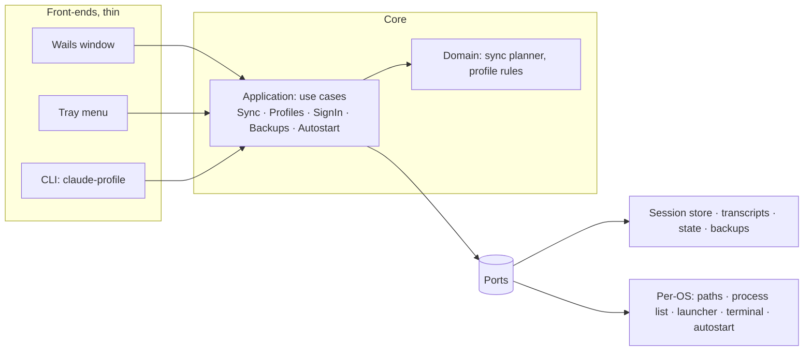

# v0.1.0 - Change Request: Cross-platform profile manager app

| | |
|---|---|
| **CR id** | CR-0.1.0-02 |
| **Version** | 0.1.0 (target; Alpha) |
| **Status** | In progress |
| **Owner** | naseebnaushad |
| **Branch** | `feature/profile-manager` |
| **Date** | 2026-11-21 |
| **Builds on** | CR-0.1.0-01 (chat sync). Its findings, decisions D1–D9 and tests remain the basis. Its Python code is replaced by this CR. |

## 1. Summary
Turn `claude-profile` into a desktop app for **macOS, Windows and Linux** that anyone can
download from the GitHub releases and use without setup. In the app you create
**named profiles** ("Work", "Seat 2", anything). Each profile has its own sign-in and
opens as its own window. All profiles share every Code-tab chat through the chat sync
from CR-0.1.0-01. Two kinds of profile are supported on every platform:
- **Desktop:** a separate Claude desktop window.
- **CLI:** a Claude Code terminal session with its own sign-in.

The app has a main window and a tray / menu bar icon. A command line with the same
features ships in the same download. The current Python tool is rewritten in Go with
**Wails v3**, with a parity checklist so no feature is lost.

## 2. Answers to the clarifying questions
| Topic | Answer |
|---|---|
| Goal | Use several Claude seats without logging out and without losing chats. A chat started on one seat can be continued on another. Easy enough to hand to anyone. |
| Users | The developer first. Then anyone who downloads the open-source release. |
| Platforms | macOS, Windows, Linux. Linux has no official Claude desktop, so desktop profiles there work with whatever Claude desktop build is found. CLI profiles work on all three. |
| In scope | Wails desktop app (window + tray). Desktop and CLI profiles: create with a free name, rename, delete, open, sign-in helper, running status. Chat sync with on/off and "last synced". Backups list and restore. A Go command line with the same features. Background sync at login. Releases for macOS (Apple Silicon + Intel), Windows (x64) and Linux (x64). |
| Out of scope | Code signing and notarisation (decision: unsigned open-source releases). Regular claude.ai chats. Syncing sidebar layout (projects, groups, pins) between desktop windows; it lives next to sign-in data (CR-01 D9). Auto-update of the app itself. |
| Edge cases | Sign-in link goes to the wrong window. A Claude update changes the file format. A chat is open on two profiles at once. A profile folder is deleted by hand. Claude is not installed. No terminal app is found (Linux). Windows without permission to create symlinks. |
| Constraints | No signing. Company rules: clean architecture, secure by default, no secrets touched, allowed licences only, docs with the code. No network calls except what Claude itself does. |
| Definition of done | A new user downloads the release, creates two profiles, signs in to each once, uses both side by side, and sees every chat in both. Nothing is lost through restarts, and a Claude update makes the app pause safely rather than guess. Verified on macOS by me; Windows and Linux are verified on a real machine, or marked "untested" in the release notes (see OQ1). |

## 3. Impact analysis
| Area / file | How it is affected | Action |
|---|---|---|
| `claude_profile/*.py`, `bin/claude-profile`, `tests/*.py` (Python tool from CR-01) | Logic is ported to Go. Python is removed once the parity checklist (section 5) is complete. | **Change** (replace) |
| `~/Library/LaunchAgents/local.claude-profile.sync.plist` (installed) | Replaced by the app starting at login and syncing from the tray. The app uninstalls the old agent on first run, with notice. | **Change** |
| `~/.claude-profile/` (backups, `state.json`, `profiles/seat2`) | The format is kept. A new `profiles.json` holds profile names and kinds. The existing `seat2` folder is adopted as a desktop profile named "seat2". | **Change** (migrate) |
| Claude desktop data, per OS: macOS `~/Library/Application Support/Claude`, Windows `%APPDATA%\Claude`, Linux `~/.config/Claude` | Same as CR-01: only `claude-code-sessions` is read and written. The Windows and Linux paths are from Electron's defaults and **unverified**. | **Change** |
| `~/.claude/` (Claude Code CLI home: `projects/`, `CLAUDE.md`, `settings.json`, `skills/`, `plugins/`…) | CLI profiles get their own folder with links back to these shared items, so they share history and settings. Only the sign-in differs. Never written by the app. | **Read / link** |
| `~/.claude.json` (CLI global state, including user MCP servers) | Each CLI profile has its own copy (it moves with `CLAUDE_CONFIG_DIR`). It is copied once when the profile is created, so MCP servers carry over (OQ4). | **Read** |
| macOS keychain, Windows/Linux `.credentials.json` | Never read or written by the app. Claude stores a separate sign-in per `CLAUDE_CONFIG_DIR` (official docs, authentication page). | **None** |
| Login items: macOS login item, Windows `HKCU\…\Run`, Linux `~/.config/autostart/*.desktop` | New. Added only when the user turns on "Start at login". | **New** |
| `README.md`, `.env.example`, `documents/`, change note | Rewritten for the app: download, first run, profiles, sync, build from source. | **Change** |
| `/Applications/Claude Profiles.app` (third-party, unused) | Untouched. Same warning as CR-01. | **None** |

Suggested related improvements (not in scope unless approved):
- **Transcript retention.** Claude Code deletes transcripts older than `cleanupPeriodDays`, 30 days by default (official docs, `.claude` directory page). Your `settings.json` doesn't set it, so **chats older than 30 days will be deleted by Claude Code itself**. The app could offer a one-click setting of a longer period (it changes your `settings.json`, so only on request).
- Show a desktop chat started from a CLI profile in the desktop sidebar too, by creating list entries for CLI sessions.
- Signed releases later, if users ask.

## 4. Design

### Architecture (company rules section 4)

- Go module layout: `internal/domain`, `internal/app`, `internal/ports`,
  `internal/adapters/{fsstore,backup,state,osmac,oswin,oslinux}`, `cmd/claude-profile`
  (CLI) and `ui/` (Wails app and frontend). The domain and use cases never import Wails
  or OS packages.
- Per-OS code uses Go build tags, so each binary contains only its own platform.

### Profiles
| | Desktop profile | CLI profile |
|---|---|---|
| What it is | Claude desktop started with `--user-data-dir=<profile folder>` | Claude Code started with `CLAUDE_CONFIG_DIR=<profile folder>` |
| Sign-in kept in | That data folder (Claude desktop) | Keychain entry keyed to the folder (macOS), or `.credentials.json` in it (Windows/Linux) |
| Chats shared by | Chat sync (CR-01) | Links from the profile folder to the shared `~/.claude/projects` and the other shared items (D12) |
| "Open" does | Starts a new window, even if others run (macOS `open -n -a`; Windows/Linux start the executable) | Opens a terminal with the variable set: macOS Terminal, Windows Terminal or `cmd`, Linux from a list of known terminals. A "Copy command" button is the fallback. |
| First sign-in | **Sign-in helper** (D11) | Claude Code asks you to log in on first open |

The **default** Claude desktop window and plain `claude` in a terminal appear as
built-in profiles called "Default". They can be renamed but not deleted.

Profiles are stored in `~/.claude-profile/profiles.json` (0600) as an id, a display
name (1–40 characters, any letters, control characters stripped) and a kind. Folders
are named by id, so renaming never moves files.

### Main window
- **Profiles:** cards showing name, kind and running/stopped, with **Open**, **Sign in**,
  **Rename** and **Delete** buttons. **+ New profile** asks for a name and a kind.
- **Sync:** on/off switch, "Last synced 2 minutes ago", **Sync now**, warnings (a chat
  used on two profiles, a format Claude changed), and the hint "Restart a window to see
  new chats".
- **Backups:** list and **Restore**. Restore asks for confirmation and requires all
  Claude windows to be closed.
- **Settings:** start at login, sync interval (1–60 minutes), open the data folder.

### Tray / menu bar
Each profile with Open, plus **Sync now**, **Open manager** and **Quit**. Closing the
window keeps the app running in the tray. Background sync runs while the app runs.

### Decisions
| # | Decision | Reason | Alternatives considered |
|---|---|---|---|
| D10 | **Go + Wails v3.1.0** (stable, released 2026-11-01, MIT). Frontend in plain TypeScript with Vite, no UI framework. | One codebase for three platforms, with a native window and tray. Wails v3 has tray and multi-window support built in. Plain TS keeps dependencies to a minimum. | Wails v2 (no built-in tray). Tauri (Rust, larger learning cost). SwiftUI (macOS only). Electron (heavy, ironic next to Claude). |
| D11 | **Sign-in helper for desktop profiles.** It lists the running Claude windows, asks before closing them, closes them gracefully, opens only the chosen profile, waits until you click "Done", then reopens the windows that were open. | The `claude://` sign-in link goes to the first running window (found in CR-01 testing). Closing the others is the only reliable way, and it's needed once per profile. | Ask the user to do it by hand (what failed in testing). |
| D12 | **CLI profiles share history through links.** The profile folder holds links to the shared `~/.claude` items (`projects`, `CLAUDE.md`, `settings.json`, `skills`, `plugins`, `agents`, `commands`, `rules`, `output-styles`, `todos`, `file-history`) and its own sign-in and `.claude.json`. Windows uses directory junctions (no admin rights needed) and falls back to file copies for the two files when symlinks aren't allowed (OQ3). | Keeps one history and one set of settings, so only the account differs. | `CLAUDE_CODE_OAUTH_TOKEN` with one folder: needs pasting a one-year token, which the app would then have to store as a secret. |
| D13 | **The CLI and the app are one binary.** `claude-profile` with no arguments opens the window; with arguments it acts as the CLI. | One download per platform, no drift between the two. | Two binaries. |
| D14 | **Unsigned releases** built by GitHub Actions for macOS (universal), Windows x64 (installer + portable .exe) and Linux x64 (AppImage + .tar.gz). The README explains the one-time "Open anyway" (macOS) and "More info → Run anyway" (Windows) steps. | Owner decision: open source, no signing. | Signing (cost). |
| D15 | **Format guard.** On startup and before each sync, check the Claude desktop chat-list format against the last tested version (Claude desktop 6.6395.1). If entries don't match, sync pauses and the app explains. | Claude updates can change internal files. Pausing is safer than guessing (CR-01 D5). | Sync blindly. |
| D16 | **Strict UI security.** CSP `default-src 'self'`, no `innerHTML` with data, all text set with `textContent`. Names are validated in Go (the core), never only in the UI. Go↔UI calls use typed bindings. | Company rules section 6. | — |

All CR-01 decisions stay in force: D3 add-only while Claude runs, D4 never delete, D5
strict format, D6 backups and atomic 0600 writes, D7 two-seat warning, D8 desktop
profiles share `~/.claude`, D9.

## 5. Feature parity (Python → Go)
| # | Existing behaviour (Python) | New location | Test | Status |
|---|---|---|---|---|
| P1 | `status`: stores, counts, plan, profiles, agent state | `tandem status` (`internal/cli`), Sync tab | Real run 2026-11-21, output identical to Python | ☑ |
| P2 | `sync` dry run by default, `--apply` writes, `--quiet` output | `tandem sync`, "Sync now", tray | SYNC-020, real run | ☑ |
| P3 | Add missing entries both ways within one org; orgs never mixed | `domain.PlanSync` | SYNC-001/002/008 | ☑ |
| P4 | Add-only while Claude runs; update older copy only when closed, re-checked before each update | `domain.PlanSync`, `app.Syncer.Sync` | SYNC-005/021 | ☑ |
| P5 | Tombstones block copies, spread only where live, never delete | `domain.PlanSync` | SYNC-003/004/011/022 | ☑ |
| P6 | Skip chats without transcript; check off if folder unreadable | `domain`, `fsstore.Transcripts` | SYNC-006/007 | ☑ |
| P7 | Strict format check, 10 MB cap, symlinks ignored, problems reported | `fsstore.Store`; plus new format guard (D15) pauses writes | SYNC-014/015/023/024 | ☑ |
| P8 | Copies reset Remote Control fields, source untouched | `domain.MakeCopy` | SYNC-016/019 | ☑ |
| P9 | Atomic writes, no overwrite on add, 0600, no temp files left | `fsstore.WriteAtomic` | SYNC-019/025 | ☑ |
| P10 | Per-copy last-sync state; warning rules; corrupt state empty | `domain.NextSynced`, `fsstore.State` (same file format, old state carried over) | SYNC-010/012/013/027/028/034 | ☑ |
| P11 | Backups: before write, 0600/0700, keep 20, restore keeps current, unsafe archives rejected | `fsstore.Backups`, `app.Manager.RestoreBackup` | SYNC-029/030/031 | ☑ |
| P12 | Profile add / list / open / remove; data kept unless asked, with confirmation | `app.Profiles`, Profiles tab, `tandem profile` | PROF-001/004/007, smoke test | ☑ |
| P13 | Profile name validation | Free display names 1–40 chars, control/bidi stripped; generated folder ids | SYNC-017, PROF-009 | ☑ |
| P14 | Output strips control and bidi characters | `domain.CleanText` in CLI; `textContent` in the page | SYNC-018 | ☑ |
| P15 | Sync every 5 min and at login, private log | `ui.syncLoop` (default 5 min) + start at login; `app.log` 0600, rotated at 1 MB. The Python LaunchAgent is removed on first start (seen in the log 2026-11-21). | Manual | ☑ |
| P16 | Env overrides | `CLAUDE_PROFILE_HOME`, `_APP_DATA`, `_PROJECTS` kept; `_APPS_DIR` dropped with the launchers (P18); `_CLAUDE_DIR` added | Smoke test | ☑ |
| P17 | Exit codes and generic errors | 0 ok, 2 usage, 1 any other error (Python used 2 for a bad name; now 1, with the same message) | Smoke test | ☑ |
| P18 | `.app` launchers in `~/Applications` | Dropped (approved, OQ6); the app window and tray open profiles | — | ☑ |

## 6. Security checklist
- [ ] Input validated and length-limited in the core: profile names, interval, backup ids. Same file limits as CR-01.
- [ ] UI: strict CSP, `textContent` only, no `eval`, no remote content loaded.
- [ ] No AuthN/AuthZ (local app); least privilege: writes only `claude-code-sessions`, `~/.claude-profile`, CLI profile folders and the login item when enabled.
- [ ] Secrets never touched: no keychain, `.credentials.json`, cookies or tokens read or copied. CLI profile creation copies `.claude.json` minus account fields (OQ4).
- [ ] Generic errors in the UI; details in `~/.claude-profile/app.log` (0600, rotated, no chat content).
- [ ] No network calls by the app.
- [ ] Dependencies: allowed licences only (check below); `govulncheck` and `npm audit` clean before Beta.
- [ ] Child processes started with argument lists, never through a shell with user text.

## 7. Dependencies
| Package | Version | Licence | Why needed |
|---|---|---|---|
| Go toolchain | 1.27.4 | BSD-3-Clause | Build (installed with your approval, 2026-11-21) |
| github.com/wailsapp/wails/v3 | v3.1.0 | MIT | Window, tray, Go↔UI bindings |
| Wails' Go dependencies | as pinned in `go.sum` | to be checked with a licence scan before the first build is accepted | — |
| @wailsio/runtime (npm) | matching v3.1.0 | MIT | Frontend bindings |
| vite (npm, build only) | 8.3.5 | MIT | Frontend build. Pulls in `lightningcss` 1.33.0 (**MPL-2.0**, build-time CSS tool, not shipped in the app): **approved by the owner 2026-11-21** (company rule 11) |
| typescript (npm, build only) | 6.0.3 | Apache-2.0 | Frontend type checks |

## 8. Test approach
- **Unit (Go):** the full CR-01 suite ported (SYNC-001…034), plus profile store, name rules, CLI profile link plan and format guard. Synthetic data only.
- **Integration (Go):** temp folders standing in for the data folders on each OS layout. Runs in GitHub Actions on macOS, Windows and Linux runners, so Windows and Linux at least get automated coverage.
- **Manual, macOS (me):** create a desktop profile, sign-in helper, side by side, chats in both, restart, tray actions, start at login, CLI profile sign-in with history shared and resume across seats.
- **Manual, Windows and Linux:** the same list, run on a real machine (OQ1).
- Results go into the Alpha Test Cases document.

## 9. Open questions
- **OQ1. Windows and Linux testing.** Is there a Windows PC/VM and a Linux machine to test on? Without one, the release notes mark them "automated tests only, not tried on a real machine".
- **OQ2. Resuming a CLI chat under another account.** Not documented. It must be tested first, as CR-01 OQ1 was, before building D12.
- **OQ3. Windows file links.** Can `CLAUDE.md` and `settings.json` be symlinked without Developer Mode? If not, they're copied and the app re-copies them when they change. Is that OK?
- **OQ4. `.claude.json` for CLI profiles.** Copy it once at creation, without the `oauthAccount` field, so MCP servers and project trust carry over? Later changes in one profile won't reach the others.
- **OQ5. App and binary name.** "Claude Profile Manager"? Note that "Claude" in an open-source app name may raise trademark questions; something like "Tandem for Claude" or "ProfileHub" avoids that.
- **OQ6.** Approve dropping the `.app` launchers (P18). The tray and app replace them.
- **OQ7. Branch rename** `feature/chat-sync` → `feature/profile-manager`, with both CRs on it?
- **OQ8. Transcript retention** (section 3 suggestion): should the app offer to raise `cleanupPeriodDays`?

## 10. Change history
| Date | Version | Change |
|---|---|---|
| 2026-11-21 | 0.1.0-alpha | CR created (Draft) |
| 2026-11-21 | 0.1.0-alpha | Approved as proposed. OQ1: automated tests only until tested on real machines. OQ2: test first. OQ3: copy fallback. OQ4: copy once without account fields. OQ5: working name "Tandem for Claude". OQ6: launchers dropped. OQ7: branch renamed. OQ8: offer on request. |
| 2026-11-21 | 0.1.0-alpha | Implemented: Go core, CLI, Wails window + tray, per-OS adapters, CI and release workflows. Parity checklist complete; Python removed. Binary name `seats`. Windows windowed builds attach to the parent console for CLI output. |
| 2026-11-21 | 0.1.0-alpha | Owner asked to build everything pending: Open brings an open profile forward; chat retention setting (OQ8: on request only); own app and tray icons; licence scan (compiled deps all allowed; build-only lightningcss is MPL-2.0, awaiting approval); packaged .app verified. |
| 2026-11-21 | 0.1.0-alpha | Owner approved `lightningcss` 1.33.0 (MPL-2.0, build-only via Vite). |
| 2026-11-21 | 0.1.0-alpha | Name chosen by the owner: **Tandem for Claude** (repo `tandem-for-claude`, command `tandem`, module `github.com/naseebnaushad/tandem-for-claude`, app id `io.github.naseebnaushad.tandemforclaude`). Personal GitHub account via Gita. The app data folder stays `~/.claude-profile` so existing profiles and sign-ins keep working. |
