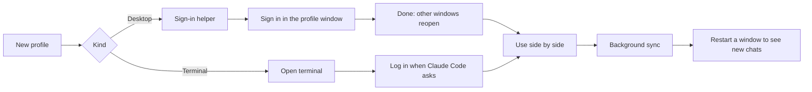
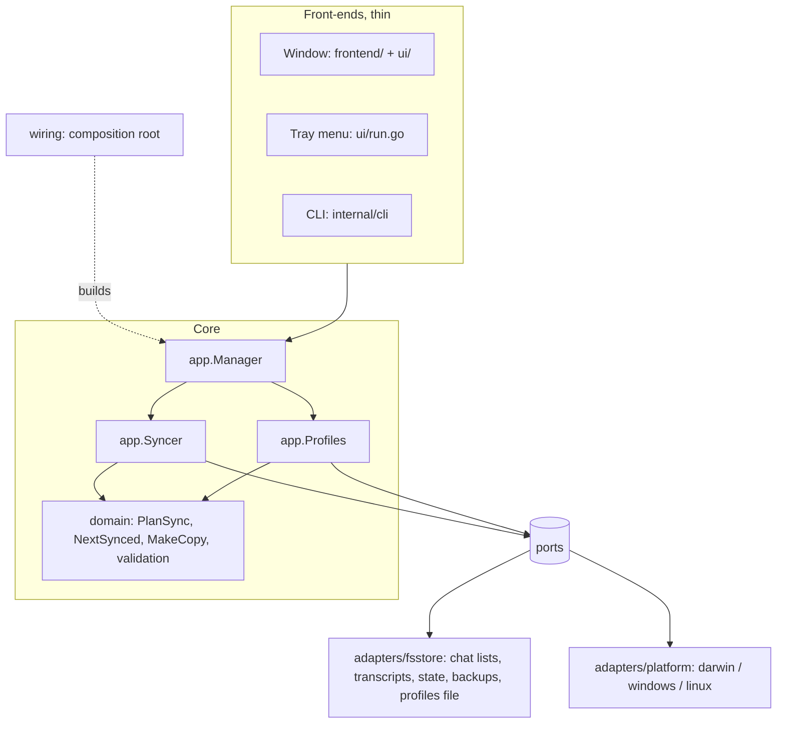
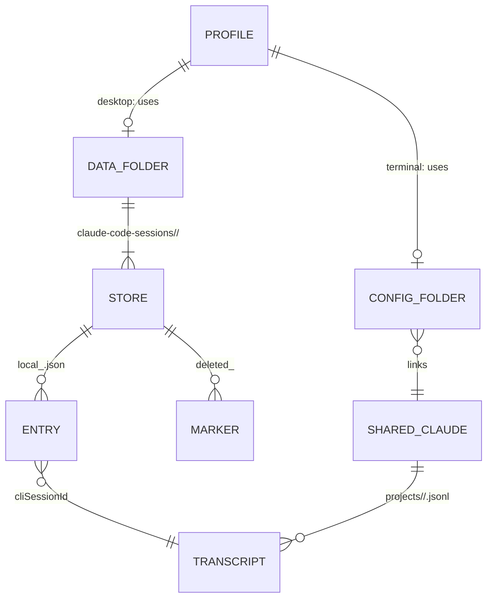

# v0.1.0 - Technical and Functional Documentation

## Contents
1. [Document control](#document-control)
2. [Version history](#version-history)
3. [Introduction](#1-introduction)
4. [Functional description](#2-functional-description)
5. [Architecture](#3-architecture)
6. [Logic and design decisions](#4-logic-and-design-decisions)
7. [Data](#5-data)
8. [Interfaces and APIs](#6-interfaces-and-apis)
9. [Configuration](#7-configuration)
10. [Security](#8-security)
11. [Build, deploy and operate](#9-build-deploy-and-operate)
12. [Dependencies](#10-dependencies)
13. [Limitations](#11-limitations)
14. [Glossary](#12-glossary)

## Document control
| Item | Value |
|---|---|
| Document | Technical and Functional Documentation |
| Version | 0.1.0-beta.2 |
| Prepared by | Claude Code, from the code, the CRs and the change notes |
| Reviewed by | naseebnaushad |
| Approved by | naseebnaushad (release owner) |
| Audience | Developers, testers, contributors |

## Version history
| Version | Date | Author | Changes |
|---|---|---|---|
| 0.1.0-beta.1 | 2026-11-21 | Claude Code for naseebnaushad | First Beta |
| 0.1.0-beta.2 | 2026-11-21 | Claude Code for naseebnaushad | Renamed to Tango for Claude (names, IDs, upgrade from beta.1); release workflow names and pre-release flag |

## 1. Introduction
**Purpose.** Tango for Claude lets one person use several Claude seats on one computer at
the same time, without logging out and without losing Code-tab chats. It's for anyone with
more than one Claude seat (for example two Claude Team premium seats).

**The problem it solves.** Claude desktop stores each Code-tab chat in two places:
- the **conversation** (transcript) in `~/.claude/projects/<project>/<id>.jsonl`, shared by
  every account on the computer;
- a **chat list entry** in `<Claude data>/claude-code-sessions/<account>/<org>/local_<id>.json`,
  one list per account.

Claude lists only the signed-in account's entries, so switching accounts hides the other
account's chats. Nothing is deleted. Tango copies list entries between accounts and runs
each seat as its own profile.

**What changed in this version.** First version. See the Release Note.

## 2. Functional description
### 2.1 Users and roles
| Role | Can do |
|---|---|
| User (the only role) | Create, rename, delete and open profiles; sign in; sync now; change settings; restore backups; use the command line |

### 2.2 Features
| Feature | Description | Rules and validations | Since |
|---|---|---|---|
| Built-in profiles | "Default (desktop)" is the normal Claude window; "Default (terminal)" is plain `claude` | Can be renamed, not deleted | 0.1.0 |
| Desktop profile | Claude desktop started with `--user-data-dir=<profile folder>`: own sign-in and chat list | Name 1–40 characters, control characters removed, unique (ignoring case) | 0.1.0 |
| Terminal profile | Claude Code started with `CLAUDE_CONFIG_DIR=<profile folder>`: own sign-in, shared history and settings through links | Same name rules | 0.1.0 |
| Open | Desktop: starts the window, or brings it forward if it's already open. Terminal: opens a terminal running `claude` | Desktop needs Claude desktop installed | 0.1.0 |
| Sign-in helper | Closes other Claude windows (after asking), opens only this profile, waits for **Done**, reopens the others | Graceful quit; gives up after 20 s and asks the user to quit them | 0.1.0 |
| Delete profile | Removes it from the list; its folder only when asked | Not while its window is open; built-ins can't be deleted; links are removed without touching `~/.claude` | 0.1.0 |
| Chat sync | Background loop (default every 5 min, 1–60) and **Sync now** | See §4.1 | 0.1.0 |
| Backups | tar.gz of every chat list before a sync that writes | Newest 20 kept; restore only with every Claude window closed | 0.1.0 |
| Keep old chats | Sets `cleanupPeriodDays` in `~/.claude/settings.json` | 30–3650 days; only on request; other settings kept; previous file saved | 0.1.0 |
| Start at login | Starts the app hidden (`--background`) | macOS LaunchAgent, Windows `Run` key, Linux XDG autostart | 0.1.0 |

### 2.3 User flows

1. **Create a profile.** Click **New profile**, type a name and choose Desktop or Terminal.
   A name that is empty, too long or already used shows "Use a name of 1 to 40
   characters." or "Another profile already has that name."
2. **Desktop sign-in.**
   - The helper lists the open windows it will close and asks first.
   - If they can't be closed, it says "Quit them yourself, then try again."
   - After you sign in and click **Done**, the windows it closed reopen.
3. **Terminal sign-in.** **Open terminal** starts `claude` with the profile's folder, and
   Claude Code asks you to log in the first time.
4. **Daily use.**
   - Open profiles from the window or the tray.
   - Sync runs in the background.
   - New chats appear in a window after it restarts.
5. **Problems.**
   - If Claude's file format changes, the Sync tab says sync is paused.
   - If two seats used the same chat since the last sync, the Sync tab warns.

## 3. Architecture

| Part | Responsibility | Location in the repo |
|---|---|---|
| Domain | Pure rules: sync plan, last-sync state, entry/marker validation, profile names. No I/O. | `internal/domain` |
| Use cases | Sync with backup and format guard; profiles and sign-in helper; settings; retention; restore | `internal/app` |
| Ports | Interfaces the use cases depend on | `internal/ports` |
| File adapters | Atomic writes, capped reads, chat-list store, transcript index, JSON state, tar.gz backups, profile and settings files | `internal/adapters/fsstore` |
| OS adapters | Paths, process list, launch / focus / quit Claude, open terminal, start at login, links | `internal/adapters/platform/{darwin,windows,linux}.go` |
| Composition root | Reads environment overrides and wires everything | `internal/wiring` |
| CLI | Argument parsing and printing | `internal/cli` |
| Window and tray | Wails v3 app, bound service, background sync loop, log | `ui/`, `frontend/` |
| Entry point | No arguments → window; arguments → CLI; Windows console attach | `main.go`, `console_*.go` |

## 4. Logic and design decisions
### 4.1 Chat sync
**How it works.**
1. **Read** every store (`<data folder>/claude-code-sessions/<account>/<org>`): the default
   Claude data folder plus each desktop profile's folder.
   - Entries must be JSON with string `sessionId`, `cliSessionId` and `cwd`, and
     `sessionId` must equal `local_<id>`.
   - Markers must be digits only.
   - Files over 10 MB, symlinks and other files are skipped and reported.
2. **Plan** per organisation (stores of different orgs never mix):
   - A chat with a deleted marker anywhere is never copied, and its marker is copied
     where the chat is still live.
   - A chat missing from a store is **added** from its newest copy (`lastActivityAt`).
   - An older copy is **updated** only when no Claude window is running.
   - A chat without a transcript is skipped.
   - A **warning** is raised when two copies' times changed since the last sync.
3. **Apply.**
   - If any file had an unexpected format, writes **pause** (format guard).
   - Otherwise a backup is taken.
   - Each action is written atomically. Adds use a hard link, which fails if the target
     appeared meanwhile. Updates check again that Claude is closed.
   - Copies reset the Remote Control fields (`bridgeSessionIds`,
     `remoteControlUserEnabled`, `remoteControlAutoEligible`, `steeredByRemoteClient`).
4. **Save** each copy's activity time as the new last-sync state. A warned chat keeps
   its old times until its copies agree again.

**Why this way.**
- Claude keeps open chats in memory and may rewrite their files, so only adding new
  files while it runs is the safest choice.
- Nothing is deleted, because a mistake must never lose a chat.
- The format is internal to Claude and can change, so the tool stops rather than guess.

| Decision | Reason | Alternatives |
|---|---|---|
| Copy entries, don't link them | Claude may replace links with files or behave oddly | Symlinks between accounts |
| Add-only while running (CR-01 D3) | No race with Claude's own writes | Always overwrite |
| Never delete; markers only (D4) | Mistakes can't lose chats | Delete entry files |
| Format guard (CR-02 D15) | Safe across Claude updates | Copy unknown files as they are |
| Per-copy last-sync state (D7) | Warns only on real two-seat use | Time window (false alarms) |

### 4.2 Profiles
- **Desktop profiles** use Electron's `--user-data-dir`. Claude allows one running copy per
  data folder, so **Open** on a running profile brings its window forward instead of
  starting a second copy:
  - macOS: System Events, by process ID.
  - Windows: `AppActivate`.
  - Linux: `wmctrl`.
- **Terminal profiles** use `CLAUDE_CONFIG_DIR`. Per the Claude Code docs, this keeps a
  separate sign-in per folder. The profile folder holds:
  - links back to the shared `~/.claude` items (`projects`, `CLAUDE.md`,
    `settings.json`, `skills`, `plugins`, `agents`, `commands`, `rules`,
    `output-styles`, `workflows`, `agent-memory`, `todos`, `file-history`);
  - its own `.claude.json`, copied once without account fields.

  On Windows, folders use junctions (no admin rights needed). Files use symlinks, or
  copies that are refreshed when the original changes.
- **Sign-in helper.** The `claude://` sign-in link goes to the first running Claude, so
  the only reliable way to sign in a new profile is to have it be the only one open.

| Decision | Reason | Alternatives |
|---|---|---|
| Profiles share `~/.claude` (CR-01 D8) | Shared transcripts are what make cross-seat resume work | Separate folders per profile |
| Links for terminal profiles (CR-02 D12) | One history and one set of settings | `CLAUDE_CODE_OAUTH_TOKEN` (needs storing a secret) |
| One binary for app and CLI (D13) | One download, no drift | Two programs |

**Names and upgrade from beta.1.** beta.1 was published as "Tandem for Claude". From
beta.2 every name is Tango:

| Item | beta.1 (Tandem) | beta.2 on (Tango) | Upgrade handling |
|---|---|---|---|
| App ID / single-instance ID | `io.github.naseebnaushad.tandemforclaude` | `io.github.naseebnaushad.tangoforclaude` | None: old and new app don't see each other, so users quit the old one (Release Note §6) |
| Command / program | `tandem` | `tango` | None: breaking for scripts |
| Start at login | `local.tandem-for-claude` (macOS), `TandemForClaude` (Windows Run), `tandem-for-claude.desktop` (Linux) | `local.tango-for-claude`, `TangoForClaude`, `tango-for-claude.desktop` | `MigrateOldAutostart` on first start removes the old entry and adds the new one |
| Copied-files record (terminal profiles) | `.tandem-copied` | `.tango-copied` | Both are read; the record is written under the new name |
| Temp files | `.tandem-*` | `.tango-*` | Leftovers of both kept out of backups |
| Retention backup | `settings.json.before-tandem` | `settings.json.before-tango` | Old file left in place |
| Data folder | `~/.claude-profile` | unchanged | — |

## 5. Data

| Where | What | Written by Tango |
|---|---|---|
| `~/.claude-profile/profiles.json` | Profile ids, names, kinds | Yes (0600) |
| `~/.claude-profile/settings.json` | Sync on/off, interval | Yes |
| `~/.claude-profile/state.json` | Last-sync time per chat copy (`<label>\|<account>\|<chat>`) | Yes |
| `~/.claude-profile/backups/*.tar.gz` | Chat-list backups, newest 20 | Yes (0600 in 0700) |
| `~/.claude-profile/app.log` | Events and errors, no chat content; rotated at 1 MB | Yes (0600) |
| `~/.claude-profile/profiles/<id>/` | A desktop profile's Claude data folder | Created; Claude writes inside |
| `~/.claude-profile/cli/<id>/` | A terminal profile's Claude Code folder | Created with links and `.claude.json` |
| `<Claude data>/claude-code-sessions/` | Chat lists | Adds and updates entries and markers only |
| `~/.claude/projects/` | Transcripts | Never written; file names read only |
| `~/.claude/settings.json` | Claude Code settings | Only `cleanupPeriodDays`, only on request |

Retention: Claude Code deletes transcripts older than `cleanupPeriodDays` (30 by default).
No data migrations: the data folder `~/.claude-profile` kept its name through the rename
to Tango, so beta.1 data is used as is. Folders made by the earlier Python tool are
adopted as profiles on first start.

## 6. Interfaces and APIs
There is no network API. The interfaces are the command line and the window's bound
service.

| Method / call | Purpose | Request | Response | Errors |
|---|---|---|---|---|
| `tango status` | Show chat lists and the dry-run plan | — | Text | 1 on error |
| `tango sync [--apply] [--quiet]` | Plan or apply sync | Flags | Text | 1 if any write failed |
| `tango profile list` | List profiles | — | id, kind, name, running | — |
| `tango profile add <name> [--kind desktop\|cli]` | Create | Name, kind | id | 1 with message, e.g. "Another profile already has that name." |
| `tango profile rename <id> <name>` | Rename | | | 1 with message |
| `tango profile open <id>` / `signin <id>` | Open / first sign-in | | | 1 with message |
| `tango profile remove <id> [--delete-data] [--yes]` | Delete | | | 1 with message |
| `tango backups list` / `restore <id> [--yes]` | Backups | | | 1 "Quit every Claude window first…" |
| `tango autostart on\|off\|status` | Start at login | | | 1 with message |
| `tango retention [days]` | Show or set chat retention | 30–3650 | | 1 "Choose between 30 and 3650 days." |
| Window service (`ui/service.go`) | Same operations for the page | Typed Wails bindings | JSON values | User-safe messages only |

Exit codes: 0 ok, 1 error (message shown), 2 usage. Example with synthetic data:
```text
$ tango profile add "Seat 2" --kind desktop
Created desktop profile "Seat 2" (id p1a2b3c4d).
Next: tango profile signin p1a2b3c4d
```

## 7. Configuration
| Setting / variable (name only) | Purpose | Default | Required |
|---|---|---|---|
| `CLAUDE_PROFILE_HOME` | App folder | `~/.claude-profile` | No |
| `CLAUDE_PROFILE_APP_DATA` | Claude desktop data folder | macOS `~/Library/Application Support/Claude`, Windows `%APPDATA%\Claude`, Linux `~/.config/Claude` | No |
| `CLAUDE_PROFILE_CLAUDE_DIR` | Claude Code shared folder | `~/.claude` | No |
| `CLAUDE_PROFILE_PROJECTS` | Transcripts folder | `<CLAUDE_DIR>/projects` | No |
| In-app: sync on/off, interval | Background sync | On, 5 minutes | — |
| In-app: start at login | Autostart | Off | — |

## 8. Security
- **No accounts or network.** The app has no login of its own and makes no network
  requests. It never reads or copies sign-ins, tokens, cookies or the keychain.
- **Input validation in the core.**
  - Profile names: 1–40 characters, with control and bidi characters removed.
  - Ids and folder names are checked against fixed patterns.
  - Interval 1–60; retention 30–3650.
  - Backup ids and archive members are checked.
- **Output.** The page sets text only with `textContent` under a strict CSP. The CLI
  removes control characters.
- **Files.**
  - Writes are atomic with 0600 permissions, and adds never overwrite.
  - Reads are capped (10 MB entries, 5 MB state and settings).
  - Symlinks are skipped.
  - Restores reject unsafe paths and keep the current folder.
- **Processes.** Commands are started with argument lists and run with 15-second
  timeouts. One exception: Windows terminal launch builds a `cmd` line from the app's own
  folder path.
- **Errors.** Users see short messages. Details go to the private log.
- **Scans** (2026-11-21): `govulncheck` clean, `npm audit` clean, secret pattern scan
  clean.

## 9. Build, deploy and operate
```bash
go install github.com/wailsapp/wails/v3/cmd/wails3@v3.1.0
```
```bash
wails3 build
```
```bash
wails3 task darwin:package APP_VERSION=0.1.0-beta.2
```
- **CI** (`.github/workflows/ci.yml`): vet and tests on macOS, Windows and Linux for every
  push and PR.
- **Release** (`.github/workflows/release.yml`):
  - Builds packages on all three systems for feature branches (as run artifacts) and for
    `v*` tags.
  - A tag creates a draft GitHub Release titled "Tango for Claude <version>" with the
    packages (`tango-for-claude-<version>-<system>-<arch>.<ext>`) and `SHA256SUMS.txt`.
    A tag with a hyphen (`v0.1.0-beta.2`) is marked as a pre-release. The owner checks
    and publishes the draft.
  - macOS is universal; Linux is built on Ubuntu 24.04 (GTK 4).
- **Operate.** Logs are in `~/.claude-profile/app.log`. To roll back data, use
  Backups → Restore. To roll back the app, install the previous release.

## 10. Dependencies
| Package | Version | Licence | Why needed |
|---|---|---|---|
| Go | 1.26+ (built with 1.27.4) | BSD-3-Clause | Language |
| github.com/wailsapp/wails/v3 | v3.1.0 | MIT | Window, tray, bindings |
| github.com/go-ole/go-ole | v1.3.0 | MIT | Wails on Windows |
| github.com/godbus/dbus/v5 | v5.2.2 | BSD-2-Clause | Wails on Linux |
| golang.org/x/sys | v0.48.0 | BSD-3-Clause | OS calls |
| @wailsio/runtime (npm) | 3.1.0 | MIT | Page ↔ Go calls |
| vite (npm, build only) | 8.3.5 | MIT | Page build; pulls in `lightningcss` 1.33.0, MPL-2.0, approved, not shipped |
| typescript (npm, build only) | 6.0.3 | Apache-2.0 | Type checks |

## 11. Limitations
- **Cross-seat resume isn't confirmed yet:** neither a desktop chat continued on the
  other seat nor `/resume` in a terminal profile (deferred to Beta).
- **Windows and Linux haven't run on real machines.** Linux has no official Claude
  desktop.
- **New chats appear only after the window restarts:** a Claude window reads its chat
  list at startup.
- **Sidebar layout isn't shared:** projects, groups and pins are separate in each desktop
  window.
- **Same icon everywhere:** every desktop window has the Claude icon.
- **Two seats writing one chat at once** can mix up its messages. There's a warning, but
  no lock.
- **Internal format:** this depends on Claude's internal chat-list layout, last checked
  with Claude desktop 6.6395.1.

## 12. Glossary
| Term | Meaning |
|---|---|
| Seat | A Claude account (for example one Team seat) |
| Profile | One seat's window or terminal in Tango, with its own sign-in |
| Store | One chat list: `claude-code-sessions/<account>/<org>` in a data folder |
| Entry | One chat in a list (`local_<id>.json`) |
| Marker | Deleted-chat file (`deleted_<id>`) |
| Transcript | The conversation (`~/.claude/projects/<project>/<id>.jsonl`) |
| Format guard | Pauses sync when chat-list files look unfamiliar |
