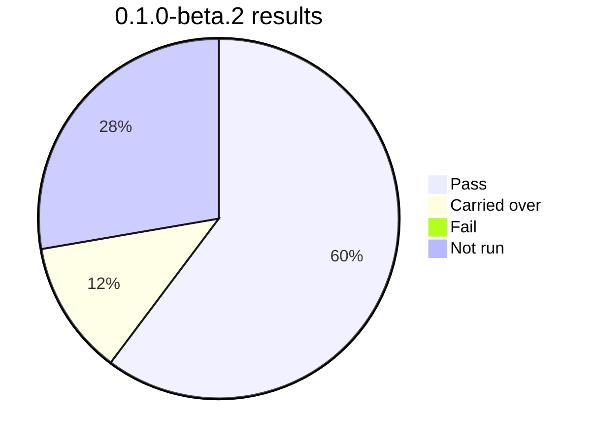

# v0.1.0 - Test Cases and Results

## Contents
1. [Document control](#document-control)
2. [Version history](#version-history)
3. [Summary](#1-summary)
4. [Scope and approach](#2-scope-and-approach)
5. [Test environment](#3-test-environment)
6. [Test cases by area](#4-test-cases-by-area)
7. [Defects](#5-defects)
8. [Not run, and why](#6-not-run-and-why)
9. [Traceability](#7-traceability)
10. [Sign-off](#8-sign-off)

## Document control
| Item | Value |
|---|---|
| Document | Test Cases and Results |
| Version | 0.1.0-beta.2 |
| Prepared by | Claude Code, from the Alpha test cases and change notes |
| Reviewed by | naseebnaushad |
| Approved by | naseebnaushad (release owner) |

## Version history
| Version | Date | Author | Changes |
|---|---|---|---|
| 0.1.0-beta.1 | 2026-11-21 | Claude Code for naseebnaushad | First Beta run |
| 0.1.0-beta.2 | 2026-11-21 | Claude Code for naseebnaushad | Rename to Tango for Claude; release workflow fix; beta.2 column and upgrade tests (PROF-010…013, REL-001/002) |

## 1. Summary
Legend: ✅ pass · ❌ fail · ⏭ not run (reason in §6) · = not repeated for this build (the change doesn't touch it; beta.1 result stands) · — not applicable (case added later).

| Build | Total | ✅ Pass | = Carried over | ❌ Fail | ⏭ Not run | Pass rate |
|---|---|---|---|---|---|---|
| 0.1.0-beta.1 | 77 | 58 | — | 0 | 19 | 75% |
| 0.1.0-beta.2 | 83 | 50 | 10 | 0 | 23 | 72% (pass + carried over) |

**Nothing failed.** beta.2 renames the app to **Tango for Claude** and fixes the release
workflow. All 45 automated tests pass on macOS, Windows and Linux, including the new
upgrade tests (PROF-010, PROF-011). The renamed app was built and checked on macOS
(PROF-013). Manual checks the rename doesn't touch were not repeated (marked =). The
release workflow fix (REL-001/002) and the packages (BUILD-004) are checked when
`v0.1.0-beta.2` is tagged.

What hasn't been run yet is what matters most for real use. The **riskiest area** is
continuing a chat on another seat in a desktop window (SYNC-M04) and in a terminal
(PROF-M07). That is the product's main promise and still needs a person with two seats to
try it. **Windows and Linux** have only been tested automatically, not on a real machine.
These were deferred to Beta testing by the release owner on 2026-11-21. They block the
0.1.0 release, but not this Beta.

## 2. Scope and approach
| Type | Covered | How |
|---|---|---|
| Functional | Sync planning and apply, profiles, sign-in helper, settings, retention, backups | Go unit and integration tests with temp folders; manual on macOS |
| Edge cases | Running vs closed Claude, deleted markers, missing transcripts, two-seat use, existing files | Unit tests SYNC-003…034 |
| Negative / error handling | Bad files, symlinks, corrupt state, unsafe archives, bad names and input | SYNC-023/024/028/030, PROF-009, RET-002 |
| Security | Format guard, atomic no-overwrite writes, archive path checks, `govulncheck`, `npm audit`, secret scan, licence scan | Automated and the `/security-check` run on 2026-11-21 |
| Regression | Same output as the earlier Python tool on real data | SYNC-M03 |
| Performance | Not measured (small local files) | — |
| Compatibility | macOS (manual + CI), Windows and Linux (CI tests and package builds only) | GitHub Actions |

Out of scope: claude.ai web chats (stored in the cloud per account); signed or notarised
builds (decision CR-0.1.0-02 D14).

## 3. Test environment
| Item | Value |
|---|---|
| Build | 0.1.0-beta.2 (`develop` at `952e2f0`); beta.1 at `947bbe9` |
| Platforms | macOS (Apple Silicon) with Claude desktop 6.6395.1 and Claude Code 2.1.318; GitHub Actions `macos-latest`, `windows-latest`, `ubuntu-24.04` |
| Test data | Synthetic only in automated tests; manual tests used the owner's own chat lists, with a backup first |
| Tools | `go test`, `go vet`, `gofmt`, `tsc`, `govulncheck` 1.10.0, `npm audit`, Wails 3.1.0 |

## 4. Test cases by area
IDs carry the area (`SYNC-001`). A case is never deleted: retired cases stay with the reason.
"Automated" means `go test ./internal/...`.

### 4.1 Sync (SYNC)
| ID | Case | Steps | Expected | Type | beta.1 | beta.2 |
|---|---|---|---|---|---|---|
| SYNC-001 | Missing entries added both ways | Automated | Each seat gets the other's chat | Functional | ✅ | ✅ |
| SYNC-002 | In-sync stores | Automated | No actions | Functional | ✅ | ✅ |
| SYNC-003 | Deleted marker blocks the copy and spreads to the live copy | Automated | Marker copied, chat not copied | Edge | ✅ | ✅ |
| SYNC-004 | Old marker without a live copy | Automated | Not copied | Edge | ✅ | ✅ |
| SYNC-005 | Newer copy updates older only when Claude is closed | Automated | Skip while running, update when closed | Edge | ✅ | ✅ |
| SYNC-006 | Missing transcript | Automated | Chat skipped and reported | Negative | ✅ | ✅ |
| SYNC-007 | Transcript folder unreadable | Automated | Check skipped, chat still added | Edge | ✅ | ✅ |
| SYNC-008 | Different organisations | Automated | Never mixed | Functional | ✅ | ✅ |
| SYNC-009 | Profile data folder | Automated | Takes part in sync | Functional | ✅ | ✅ |
| SYNC-010 | Both seats changed a chat since last sync | Automated | Warning | Edge | ✅ | ✅ |
| SYNC-011 | No deletes | Automated | No action deletes | Security | ✅ | ✅ |
| SYNC-012 | Only one seat changed | Automated | No warning | Edge | ✅ | ✅ |
| SYNC-013 | State holds a warned chat until copies agree | Automated | Held, then updated | Edge | ✅ | ✅ |
| SYNC-014 | Entry format check | Automated | Bad shapes rejected, numbers exact | Negative | ✅ | ✅ |
| SYNC-015 | Marker format check | Automated | Only digits accepted | Negative | ✅ | ✅ |
| SYNC-016 | Copy resets only account fields | Automated | Source untouched | Security | ✅ | ✅ |
| SYNC-017 | Profile display names | Automated | 1–40 chars, control characters removed | Negative | ✅ | ✅ |
| SYNC-018 | Shown text cleaned | Automated | Control and bidi characters removed | Security | ✅ | ✅ |
| SYNC-019 | Apply | Automated | Copy written 0600, fields cleared, no temp files | Functional | ✅ | ✅ |
| SYNC-020 | Dry run | Automated | Nothing written, no backup | Functional | ✅ | ✅ |
| SYNC-021 | Running Claude never overwritten | Automated | Update only once closed | Security | ✅ | ✅ |
| SYNC-022 | Marker copied, entry kept | Automated | Entry file still there | Security | ✅ | ✅ |
| SYNC-023 | Bad files and format guard | Automated | Reported; writes paused | Negative | ✅ | ✅ |
| SYNC-024 | Symlinked entry | Automated | Ignored | Security | ✅ | ✅ |
| SYNC-025 | Add never replaces a file | Automated | Existing file kept | Security | ✅ | ✅ |
| SYNC-026 | Sync into a profile folder | Automated | Entry copied | Functional | ✅ | ✅ |
| SYNC-027 | Two-seat warning end to end | Automated | Warning only after both seats used it | Edge | ✅ | ✅ |
| SYNC-028 | Corrupt state file | Automated | Read as empty | Negative | ✅ | ✅ |
| SYNC-029 | Backup and restore | Automated | Backup 0600; restore keeps the current folder | Functional | ✅ | ✅ |
| SYNC-030 | Unsafe archive | Automated | Rejected; nothing written outside | Security | ✅ | ✅ |
| SYNC-031 | Backup limit | Automated | Newest 20 kept | Functional | ✅ | ✅ |
| SYNC-034 | Stale copies on other seats | Automated | No warning | Edge | ✅ | ✅ |
| SYNC-M01 | Copied entry listed under the other account | 1. Copy an entry 2. Restart Claude 3. Open it | Listed; history loads | Functional | ✅ (2026-11-20) | = |
| SYNC-M02 | First real sync | 1. `sync --apply` | 16 and 7 chats become 22 each; backup taken | Functional | ✅ (2026-11-20) | = |
| SYNC-M03 | Go tool matches the Python tool | 1. `tango status` on real data (beta.1: `tandem status`) | Same result; old state carried over | Regression | ✅ | ✅ |
| SYNC-M04 | Continue a desktop chat on the other seat | 1. Open a chat from seat 1 in the seat 2 window 2. Send a message | Reply keeps the earlier context | Functional | ⏭ | ⏭ |
| SYNC-M05 | Deleted chat stays deleted on the other seat (CR-01 OQ3) | 1. Delete on seat 1 2. Sync 3. Restart seat 2 | Chat gone on seat 2 | Edge | ⏭ | ⏭ |
| SYNC-M06 | Claude keeps entries it didn't create (CR-01 OQ2, OQ5) | 1. Sync 2. Use and restart both seats, update Claude | Copied entries stay; Remote Control unaffected | Edge | ⏭ | ⏭ |

### 4.2 Profiles (PROF)
| ID | Case | Steps | Expected | Type | beta.1 | beta.2 |
|---|---|---|---|---|---|---|
| PROF-001 | Create, rename, delete desktop profile | Automated | Data kept unless asked | Functional | ✅ | ✅ |
| PROF-002 | Built-in profiles | Automated | Rename yes, delete no | Negative | ✅ | ✅ |
| PROF-003 | Terminal profile set-up | Automated | Shared items linked; account removed from `.claude.json`; numbers exact | Functional | ✅ | ✅ |
| PROF-004 | Delete terminal profile | Automated | Shared `~/.claude` untouched | Security | ✅ | ✅ |
| PROF-005 | Copy fallback when links aren't allowed | Automated | Re-copied when the original changes | Edge | ✅ | ✅ |
| PROF-006 | Sign-in helper | Automated | Others closed, profile opened, others reopened | Functional | ✅ | ✅ |
| PROF-007 | Open on an already-open profile | Automated | Window brought forward, no second copy | Functional | ✅ | ✅ |
| PROF-008 | Adopt existing folders | Automated | Profiles created from them | Regression | ✅ | ✅ |
| PROF-009 | Bad names and kinds | Automated | Rejected | Negative | ✅ | ✅ |
| PROF-M01 | App window | 1. Open the app | Profiles listed, open/closed correct, dark mode | Functional | ✅ | = |
| PROF-M02 | Old Python background job | 1. First start | Removed, logged | Regression | ✅ | = |
| PROF-M03 | Terminal profile commands | 1. add 2. rename 3. remove --delete-data (temp home) | Works; shared `~/.claude` intact | Functional | ✅ | = |
| PROF-M04 | Start at login | 1. `autostart on` 2. `off` | Valid LaunchAgent written, then removed | Functional | ✅ | = |
| PROF-M05 | Desktop sign-in helper end to end | 1. Sign in on a new profile 2. Done | Signed in as the right seat; others reopen | Functional | ⏭ | ⏭ |
| PROF-M06 | Tray menu | 1. Open a profile 2. Sync now 3. Quit | Each works | Functional | ⏭ | ⏭ |
| PROF-M07 | Resume a terminal chat on the other seat (CR-02 OQ2) | 1. Open terminal profile 2. Log in with seat 2 3. `/resume` 4. Send | Reply keeps context | Functional | ⏭ | ⏭ |
| PROF-M08 | Packaged app | 1. `wails3 task darwin:package` 2. Open | Starts with the new icon; second launch hands over | Functional | ✅ | = |
| PROF-M09 | Bring window forward | 1. Open on the running default profile | Real Claude window comes to the front | Functional | ✅ | = |
| PROF-010 | Upgrade: terminal profile made by beta.1 (old `.tandem-copied` record) | Automated | Copied files still refreshed; record moved to `.tango-copied` | Regression | — | ✅ |
| PROF-011 | Upgrade: start at login moves from the old "Tandem" entry (macOS, Linux) | Automated (Linux test runs in CI) | Old entry removed; new entry points at `tango` | Regression | — | ✅ |
| PROF-012 | Upgrade: Windows Run entry moves from `TandemForClaude` to `TangoForClaude` | 1. Turn on start at login in beta.1 2. Install beta.2 and open it | Only the new entry remains | Regression | — | ⏭ |
| PROF-013 | Renamed app | 1. Build the package 2. `tango version`, `tango help`, `tango profile list` 3. Check the bundle name and ID | All say Tango for Claude; existing profiles listed unchanged | Functional | — | ✅ |

### 4.3 Retention (RET)
| ID | Case | Steps | Expected | Type | beta.1 | beta.2 |
|---|---|---|---|---|---|---|
| RET-001 | Change retention | Automated | Other settings and numbers kept; old file saved | Functional | ✅ | ✅ |
| RET-002 | Bad retention input or file | Automated | Refused; nothing changed | Negative | ✅ | ✅ |
| RET-M01 | Apply on real settings | 1. Settings → Keep old chats → Apply | `cleanupPeriodDays` set; other settings kept | Functional | ⏭ | ⏭ |

### 4.4 Build, release, CI and licences (BUILD, REL, LIC)
| ID | Case | Steps | Expected | Type | beta.1 | beta.2 |
|---|---|---|---|---|---|---|
| BUILD-001 | macOS build with version stamp | `wails3 build` with `APP_VERSION` | `tango version` shows it | Functional | ✅ | ✅ |
| BUILD-002 | Windows cross-compile | `GOOS=windows go build` | Compiles | Compatibility | ✅ | ✅ |
| BUILD-003 | CI tests on three systems | Push to GitHub | macOS, Windows, Linux pass | Compatibility | ✅ | ✅ |
| BUILD-004 | Release packages on three systems | Release workflow on the feature branch | `.app` zip, Windows installer and portable exe, AppImage and tar.gz | Compatibility | ✅ | ⏭ |
| LIC-001 | Licences of compiled-in code | Read module licence files | All MIT or BSD | Security | ✅ | = |
| LIC-002 | Build-only npm tools | Read package licences | MPL-2.0 `lightningcss` approved by the owner | Security | ✅ | = |
| REL-001 | Release downloads named `tango-for-claude-<version>-…` | Release workflow on the next tag | No `dist-` prefix; checksums file matches | Functional | — | ⏭ |
| REL-002 | Beta tag creates a pre-release | Push `v0.1.0-beta.2` | Draft is marked pre-release, titled "Tango for Claude 0.1.0-beta.2" | Functional | — | ⏭ |

### 4.5 Windows (WIN) and Linux (LNX) on a real machine
| ID | Case | Expected | Type | beta.1 | beta.2 |
|---|---|---|---|---|---|
| WIN-001 / LNX-001 | Install and first start (unsigned) | Starts after the one-time step | Compatibility | ⏭ / ⏭ | ⏭ / ⏭ |
| WIN-002 / LNX-002 | Claude desktop found, open/closed state | Correct (Linux: community build) | Compatibility | ⏭ / ⏭ | ⏭ / ⏭ |
| WIN-003 / LNX-003 | Desktop profile side by side | Own sign-in | Compatibility | ⏭ / ⏭ | ⏭ / ⏭ |
| WIN-004 / LNX-004 | Terminal profile | Terminal opens; links or copy fallback | Compatibility | ⏭ / ⏭ | ⏭ / ⏭ |
| WIN-005 / LNX-005 | Command-line output | Visible in the terminal | Compatibility | ⏭ / ⏭ | ⏭ / ⏭ |
| WIN-006 / LNX-006 | Start at login | Starts hidden at login | Compatibility | ⏭ / ⏭ | ⏭ / ⏭ |

## 5. Defects
Found and fixed:

| # | Found in | Test | Description | Severity | Status | Fixed in |
|---|---|---|---|---|---|---|
| D-01 | alpha | SYNC-004 | Deleted markers copied to seats that never had the chat | Low | Fixed | alpha |
| D-02 | alpha | SYNC-012/034 | "Used on two seats" warning fired for fresh or stale copies | Medium | Fixed | alpha |
| D-03 | alpha | BUILD-003 | Permission checks failed on Windows, which has no POSIX bits | Low | Fixed | alpha |
| D-04 | alpha | BUILD-004 | Linux packages failed: Wails 3.1 needs GTK 4 / WebKitGTK 6.0 | High | Fixed (build on Ubuntu 24.04) | alpha |
| D-05 | beta.1 | BUILD-004, REL-001 | Release downloads had a `dist-` prefix and the Beta wasn't marked as a pre-release (beta.1 fixed by hand) | Low | Fixed, confirmed at the next tag | beta.2 |

## 6. Not run, and why
| ID | Reason | Who / when |
|---|---|---|
| SYNC-M04, SYNC-M05, SYNC-M06, PROF-M05, PROF-M06, PROF-M07, RET-M01 | Need the owner's second seat and real use; deferred to Beta testing by the release owner on 2026-11-21 | naseebnaushad, during Beta |
| WIN-001…006 | No Windows machine available yet | Volunteer or owner, during Beta |
| LNX-001…006 | No Linux machine available; no official Claude desktop for Linux | Volunteer, during Beta |
| PROF-012 | Needs a real Windows PC with beta.1 installed | Volunteer or owner, during Beta |
| BUILD-004, REL-001, REL-002 | The release workflow runs only when a version tag is pushed | Checked when `v0.1.0-beta.2` is tagged |

## 7. Traceability
| Requirement / CR item | Test cases |
|---|---|
| CR-0.1.0-01 §4 chat sync rules | SYNC-001…031, SYNC-034, SYNC-M01…M03 |
| CR-0.1.0-01 OQ2, OQ3, OQ5 (deferred) | SYNC-M05, SYNC-M06 |
| CR-0.1.0-02 profiles (desktop, terminal) | PROF-001…009, PROF-M01…M09 |
| CR-0.1.0-02 D11 sign-in helper | PROF-006, PROF-M05 |
| CR-0.1.0-02 D12 / OQ2 terminal profiles share history | PROF-003…005, PROF-M07 |
| CR-0.1.0-02 OQ8 retention | RET-001, RET-002, RET-M01 |
| CR-0.1.0-02 D14 releases for three systems | BUILD-001…004, WIN/LNX-001…006 |
| CR-0.1.0-02 §6 security, rule 11 licences | SYNC-011/016/018/021/024/025/030, LIC-001/002 |
| CR-0.1.0-02 §5 parity checklist | SYNC-M03, PROF-M02 |
| Rename to Tango for Claude (change note fix/rename-to-tango) | PROF-010…013, SYNC-M03, BUILD-001 |
| Release workflow fix (change note fix/release-asset-names) | REL-001, REL-002, BUILD-004 |

## 8. Sign-off
| Role | Name | Date | Decision |
|---|---|---|---|
| QA | Claude Code (automated runs) | 2026-11-21 | beta.2: automated and macOS checks pass |
| Release owner | naseebnaushad | | Pending review |
